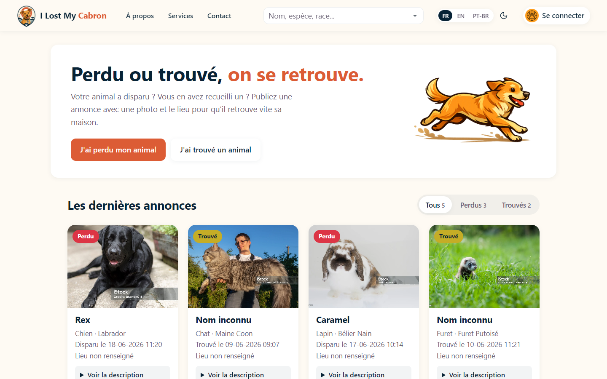
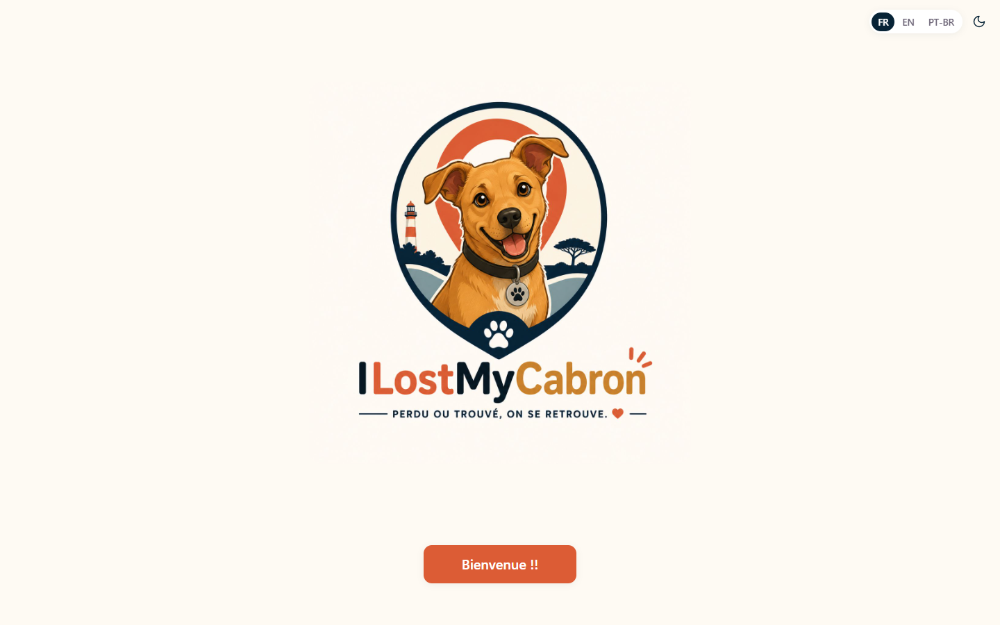
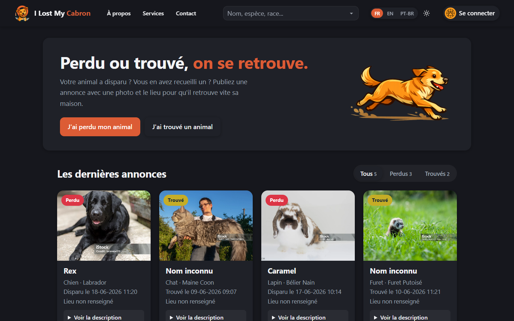
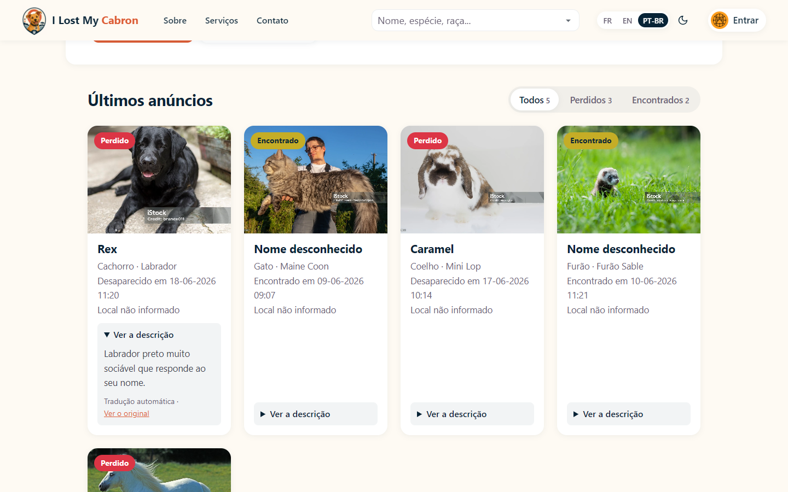
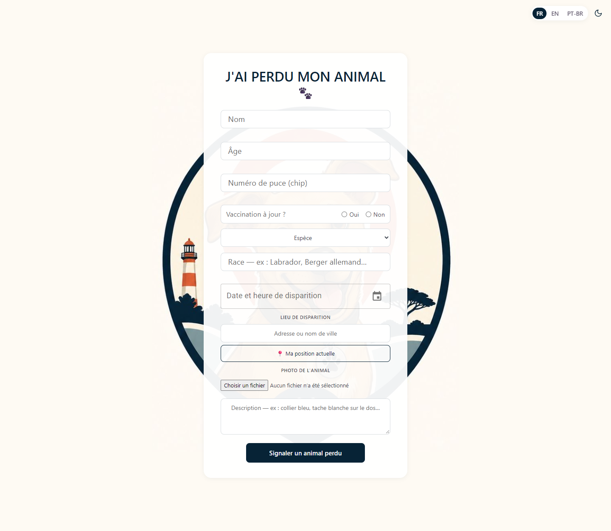
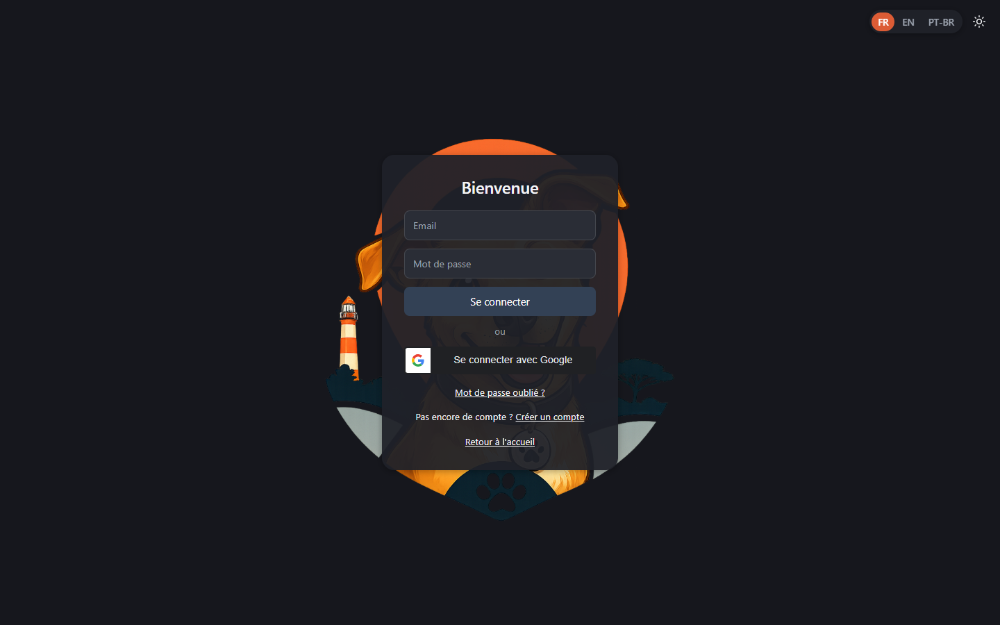
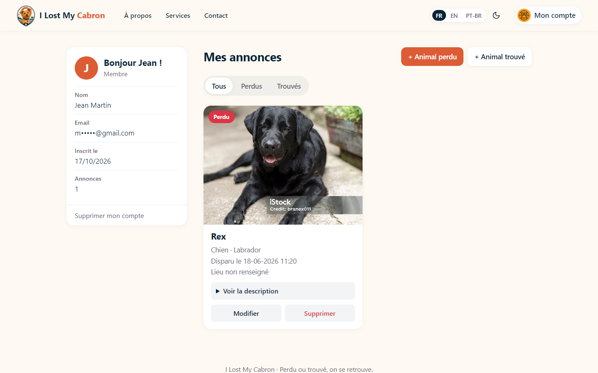
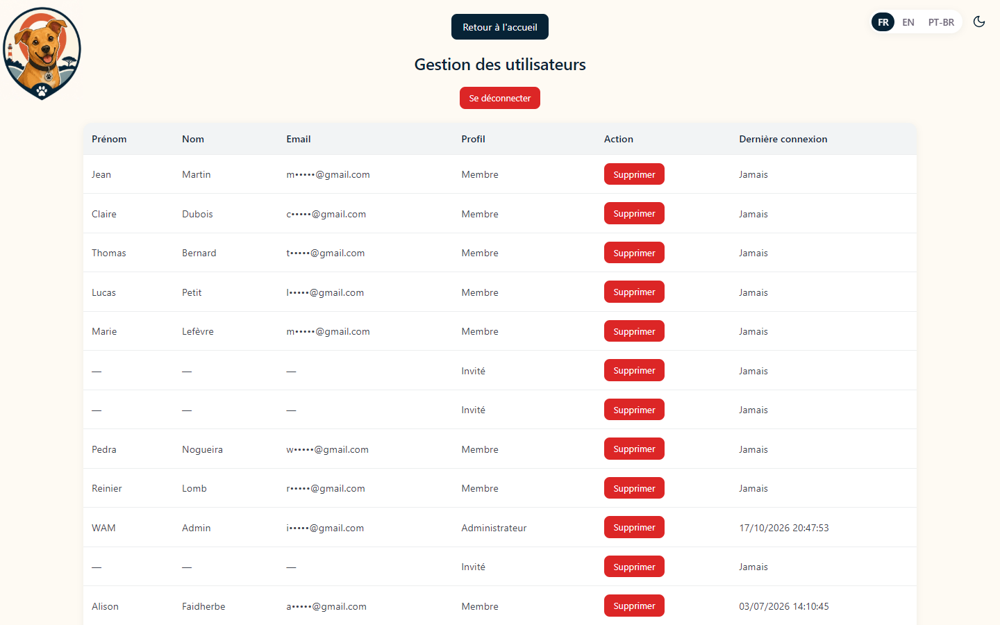
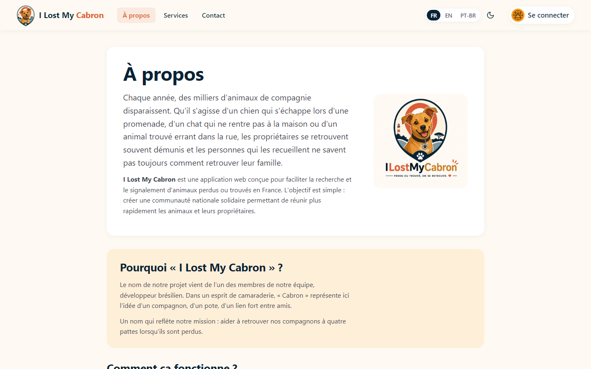
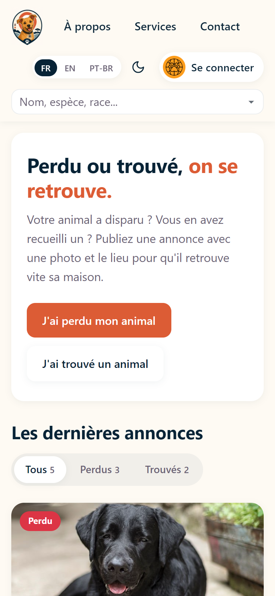

<h1 align="center">🐾 I Lost My Cabron</h1>

<p align="center">
  <b>Plateforme web de signalement d'animaux perdus et trouvés</b><br>
  <i>Perdu ou trouvé, on se retrouve.</i>
</p>

<p align="center">
  
  
  
  
  
  
  
</p>

<p align="center">
  🇫🇷 Français · 🇬🇧 English · 🇧🇷 Português (Brasil) — ☀️ mode clair / 🌙 mode sombre
</p>

<p align="center">
  
</p>

---

## 📖 À propos du projet

**I Lost My Cabron** est une application web développée en équipe, dont l'objectif est de faciliter la recherche et le signalement d'animaux de compagnie perdus ou trouvés.

Chaque année, des milliers d'animaux disparaissent. Les propriétaires se retrouvent démunis, et les personnes qui recueillent un animal errant ne savent pas toujours comment retrouver sa famille. **I Lost My Cabron** propose une solution simple et centralisée pour croiser les annonces « perdu » et « trouvé » et réunir les compagnons à quatre pattes avec leurs propriétaires.

> 💡 **Pourquoi ce nom ?** Le nom vient d'un membre brésilien de l'équipe : « Cabron » y représente l'idée d'un compagnon, d'un pote, d'un lien fort — un clin d'œil à la mission du projet.

---

## ✨ Fonctionnalités

**Annonces**
- 📢 Publication d'annonces « perdu » ou « trouvé » : photo, espèce, race, âge, puce, vaccination, date, lieu, description
- 🔎 Recherche par nom, espèce, race, statut, numéro de puce ou description, et onglets Tous / Perdus / Trouvés
- ✏️ Modification et suppression de ses propres annonces depuis son compte
- 📍 Bouton « Ma position actuelle » qui remplit la ville automatiquement (OpenStreetMap / Nominatim)
- 🖼️ Photos stockées sur **Supabase Storage**

**Comptes**
- 🔐 Inscription, connexion, connexion avec **Google**, mot de passe oublié par email
- 👤 **Mode invité** : publier sans créer de compte, avec un code de suivi à 5 chiffres pour retrouver ses annonces
- 🛠️ **Espace administrateur** : liste des utilisateurs, dernières connexions, suppression de comptes
- 🛡️ Limitation des tentatives de connexion (protection contre les essais en série)

**Confort**
- 🌙 **Mode sombre** sur tout le site (suit le réglage de l'appareil, puis le choix de l'utilisateur est mémorisé)
- 🌍 **Site en 3 langues** : français, anglais et portugais du Brésil
- 🤖 **Traduction automatique des annonces** : les descriptions écrites par les utilisateurs sont traduites dans la langue choisie, avec un lien « Voir l'original »
- 📱 Site adapté au mobile

---

## 📸 Aperçu

### Page d'intro et annonces

<table>
<tr>
<td width="50%" align="center"><b>Intro</b></td>
<td width="50%" align="center"><b>Annonces en mode sombre</b></td>
</tr>
<tr>
<td></td>
<td></td>
</tr>
</table>

### Site multilingue + traduction automatique
Le site en portugais du Brésil : l'interface est traduite, et la description de l'annonce (écrite en français par l'utilisateur) est traduite automatiquement.



### Publier une annonce, se connecter

<table>
<tr>
<td width="50%" align="center"><b>Formulaire « J'ai perdu mon animal »</b></td>
<td width="50%" align="center"><b>Connexion (mode sombre)</b></td>
</tr>
<tr>
<td></td>
<td></td>
</tr>
</table>

### Espace utilisateur
Profil, annonces publiées, modification et suppression.



### Espace administrateur
Gestion des utilisateurs et suivi des dernières connexions.



### À propos et version mobile

<table>
<tr>
<td width="70%" align="center"><b>À propos</b></td>
<td width="30%" align="center"><b>Mobile</b></td>
</tr>
<tr>
<td></td>
<td></td>
</tr>
</table>

---

## 🧱 Stack technique

| Côté | Technologies |
|------|--------------|
| **Frontend** | React 19 (Vite), React Router, MUI (Joy + date pickers), React Hook Form, Bootstrap |
| **Backend** | Node.js, Express |
| **Base de données** | MongoDB (Mongoose) |
| **Authentification** | JWT, Google OAuth 2.0, bcrypt |
| **Emails** | Nodemailer (mot de passe oublié) |
| **Stockage des photos** | Supabase Storage |
| **Géolocalisation** | Nominatim (OpenStreetMap) |
| **Traduction des annonces** | API MyMemory |

---

## 📁 Organisation du dépôt

```
caramelo-app/                 → back-end (API Express, port 3000)
front-end/frontend-caramelo/  → front-end (React + Vite, port 5173)
  src/i18n/traductions.js     → tous les textes du site en FR / EN / PT-BR
json/                         → données de test à importer dans MongoDB
img/                          → captures d'écran du README
```

---

## 🚀 Installation en local

**Prérequis :** Node.js 20+ et MongoDB (local ou MongoDB Atlas).

```bash
# 1. Cloner le dépôt
git clone https://github.com/wall966/iLostMyCabron.git
cd iLostMyCabron

# 2. Back-end
cd caramelo-app
npm install
cp .env.example .env      # puis remplir les valeurs
npm start                 # → http://localhost:3000

# 3. Front-end (dans un 2e terminal)
cd front-end/frontend-caramelo
npm install
cp .env.example .env      # puis remplir les valeurs
npm run dev               # → http://localhost:5173
```

Pour avoir des annonces de démonstration, importer les fichiers du dossier `json/` dans la base `ILostMyCabron` (avec MongoDB Compass : *Add data → Import JSON*).

### Variables d'environnement

Les fichiers `.env.example` listent toutes les variables. **Ne jamais mettre les vrais `.env` sur GitHub** (ils sont dans le `.gitignore`).

| Fichier | Variable | Rôle |
|---------|----------|------|
| `caramelo-app/.env` | `MONGO_URI` | Adresse de la base MongoDB |
| | `JWT_SECRET` | Clé secrète des tokens de connexion |
| | `EMAIL_USER` / `EMAIL_PASS` | Compte Gmail qui envoie les mails « mot de passe oublié » |
| | `FRONTEND_URL` | Adresse du site (liens des mails + autorisation CORS) |
| | `GOOGLE_CLIENT_ID` | Identifiant Google OAuth |
| `front-end/frontend-caramelo/.env` | `VITE_API_URL` | Adresse de l'API (par défaut `http://localhost:3000`) |
| | `VITE_SUPABASE_URL` / `VITE_SUPABASE_ANON_KEY` | Stockage des photos |
| | `VITE_GOOGLE_CLIENT_ID` | Bouton « Se connecter avec Google » |

---

## 🌐 Mise en ligne

Le front et le back s'hébergent séparément :

1. **Base de données** : créer une base gratuite sur [MongoDB Atlas](https://www.mongodb.com/atlas) et y importer les données.
2. **Back-end** (ex. [Render](https://render.com)) : dossier `caramelo-app`, commande `npm start`, et renseigner les variables du `.env` dans l'hébergeur (`MONGO_URI` d'Atlas, `FRONTEND_URL` = adresse du site en ligne).
3. **Front-end** (ex. [Vercel](https://vercel.com) ou [Netlify](https://www.netlify.com)) : dossier `front-end/frontend-caramelo`, commande `npm run build`, dossier `dist`, et `VITE_API_URL` = adresse du back en ligne. Ajouter une règle de réécriture vers `index.html` pour que les liens (`/welcome`, `/account`…) fonctionnent.
4. **Google OAuth** : ajouter l'adresse du site en ligne dans les « origines JavaScript autorisées » de la console Google Cloud.

---

## 🗺️ Roadmap

- [x] Mode sombre
- [x] Site en 3 langues + traduction automatique des annonces
- [ ] Carte interactive des animaux perdus / trouvés
- [ ] Rapprochement automatique entre annonces « perdu » et « trouvé » par géolocalisation
- [ ] Notifications quand un animal est signalé près de chez soi
- [ ] Intégration de tags **NFC** pour un signalement encore plus rapide
- [ ] Application mobile avec **Flutter**

---

## 👥 Équipe

Projet développé en équipe dans le cadre de la formation DWWM, en méthodologie Git collaborative (une branche par contributeur).
