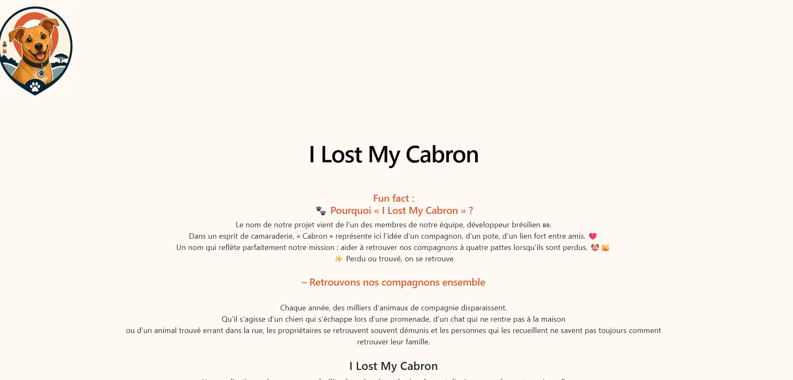
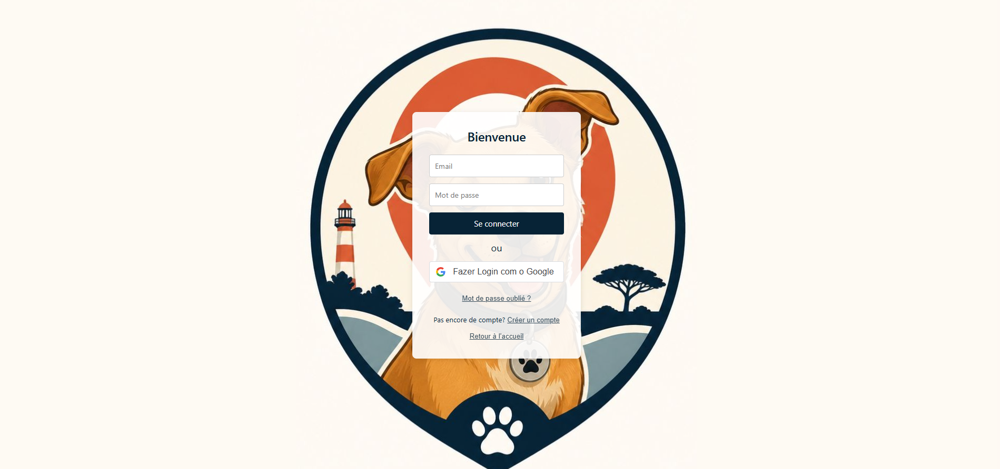
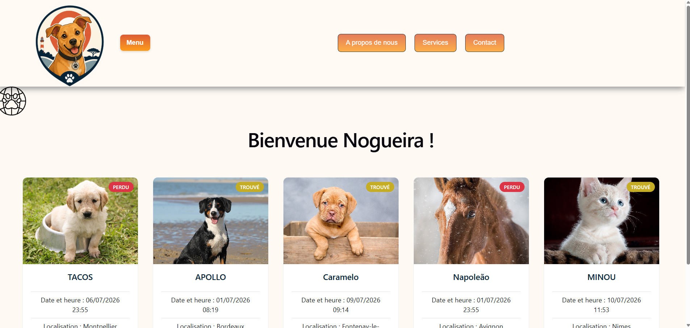
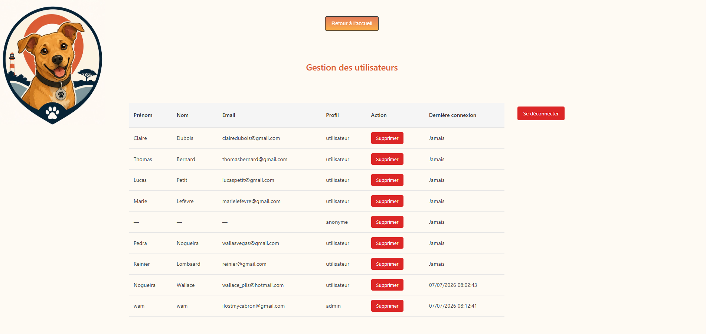

<p align="center">
 
</p>

<h1 align="center">🐾 I Lost My Cabron</h1>

<p align="center">
  <b>Plateforme web de signalement d'animaux perdus et trouvés</b><br>
  Chiens • Chats • Équidés
</p>

<p align="center">
  
  
  
  
  
  
</p>

---

## 📖 À propos du projet

**I Lost My Cabron** est une application web développée dans le cadre d'un projet d'équipe, dont l'objectif est de faciliter la recherche et le signalement d'animaux de compagnie perdus ou trouvés : **chiens, chats et équidés**.

Chaque année, des milliers d'animaux disparaissent. Les propriétaires se retrouvent démunis, et les personnes qui recueillent un animal errant ne savent pas toujours comment retrouver sa famille. **I Lost My Cabron** propose une solution simple et centralisée pour croiser les annonces « perdu » et « trouvé » et réunir les compagnons à quatre pattes avec leurs propriétaires.

> 💡 **Pourquoi ce nom ?** Le nom vient d'un membre brésilien de l'équipe : « Cabron » y représente ici l'idée d'un compagnon, d'un pote, d'un lien fort — un clin d'œil chaleureux à la mission du projet : *Perdu ou trouvé, on se retrouve.*

---

## ✨ Fonctionnalités principales

- 📢 Publication d'annonces d'animaux perdus ou trouvés (avec photo, localisation, description)
- 🔐 Authentification complète : inscription, connexion, connexion via **Google OAuth**
- 👤 **Mode invité** : possibilité de publier une annonce de façon anonyme, sans créer de compte
- 🗺️ Géolocalisation des annonces via **OpenStreetMap / Nominatim**
- 🖼️ Stockage des photos d'animaux via **Supabase Storage**
- 🛠️ **Panneau d'administration** : gestion des utilisateurs, suppression de comptes, suivi des dernières connexions
- 📄 Page « À propos de nous » présentant le projet et l'équipe

---

## 📸 Aperçu de l'application

### 1. Présentation du projet


<br>

### 2. Parcours d'authentification

<table>
<tr>
<td width="33%" align="center"><b>Inscription</b></td>
<td width="33%" align="center"><b>Connexion</b></td>
<td width="33%" align="center"><b>Mode invité</b></td>
</tr>
<tr>
<td></td>
<td></td>
<td></td>
</tr>
<tr>
<td align="center">Création de compte + connexion Google</td>
<td align="center">Connexion classique ou via Google</td>
<td align="center">Publication anonyme sans compte</td>
</tr>
</table>

<br>

### 3. Espace utilisateur
Tableau de bord personnel : suivi et gestion des annonces publiées par l'utilisateur connecté.



<br>

### 4. Panneau d'administration
Gestion des utilisateurs, suivi des dernières connexions et modération des comptes.



---

## 🧱 Stack technique

| Côté | Technologies |
|------|--------------|
| **Frontend** | React (Vite), JavaScript, MUI / React-Bootstrap, React Hook Form |
| **Backend** | Node.js, Express.js |
| **Base de données** | MongoDB (Mongoose) |
| **Authentification** | JWT + Google OAuth 2.0 |
| **Stockage de fichiers** | Supabase Storage (photos des animaux) |
| **Géolocalisation** | API Nominatim (OpenStreetMap) |

---

## 🚀 Installation

```bash
# Cloner le dépôt
git clone https://github.com/Alliiissonnee/I-Lost-My-Cabron.git
cd I-Lost-My-Cabron

# Installer les dépendances (frontend et backend)
npm install

# Lancer le backend
cd backend
npm run dev

# Lancer le frontend (nouveau terminal)
cd frontend
npm run dev
```

L'application est accessible par défaut sur :
- Frontend : `http://localhost:5173`
- Backend : `http://localhost:3000`

> ⚠️ N'oubliez pas de configurer vos variables d'environnement (`.env`) pour MongoDB, Supabase et Google OAuth.

---

## 🗺️ Roadmap

- [ ] Intégration de tags **NFC** pour un signalement encore plus rapide
- [ ] Portage de l'application vers **Flutter** (mobile)
- [ ] Système de matching automatique entre annonces « perdu » et « trouvé » par géolocalisation

---

## 👥 Équipe

Projet développé en équipe dans le cadre d'un projet académique / personnel, en méthodologie Git collaborative (branches par contributeur).

---


